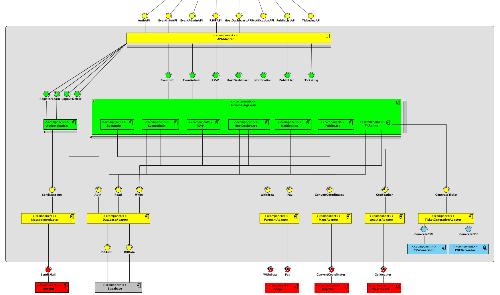

# Architekturentwurf

## Komponentendiagramm

Das folgende Diagramm zeigt den ursprünglichen Architekturentwurf des Happin-Backends.

Die Backend-Komponenten lassen sich in drei Schichten einteilen:

1. **API-Schicht** – der `APIAdapter` empfängt alle HTTP-Anfragen
2. **Anwendungskern** – fachliche Komponenten für Events, Tickets, Zahlungen usw.
3. **Adapter-Schicht** – kapselt alle externen Dienste und die Datenbank

---

## Umsetzung des Entwurfes

### APIAdapter

*✅ vollständig umgesetzt*

Der Entwurf sieht einen zentralen `APIAdapter` vor, der alle API-Schnittstellen bereitstellt. In der Implementierung entspricht dieser dem Modul `app/api/v1/` mit dem aggregierenden `router.py` sowie den einzelnen Router-Dateien (`events.py`, `tickets.py`, `payments.py`, …).

Die im Entwurf definierten Schnittstellen sind direkt als FastAPI-Endpunkte realisiert:

| Entwurfs-Schnittstelle | Implementierung |
|---|---|
| `AuthAPI` | `app/api/v1/user.py`, `app/api/v1/users.py` |
| `EventInfoAPI` | `app/api/v1/events.py` (GET-Endpunkte) |
| `EventAdminAPI` | `app/api/v1/events.py` (POST/PATCH/DELETE) |
| `RSVPAPI` | `app/api/v1/events.py` (RSVP-Endpunkte) |
| `HostDashboardAPI` | `app/api/v1/events.py`, `app/api/v1/users.py` |
| `NotificationAPI` | `app/api/v1/notifications.py` |
| `PublicListAPI` | `app/api/v1/events.py` (öffentliche Listenendpunkte) |
| `TicketingAPI` | `app/api/v1/tickets.py`, `app/api/v1/ticket_options.py` |

### Authentication

*✅ vollständig umgesetzt*

[→ Im Architekturentwurf ansehen](<https://gitlab.com/groups/dhbw-se/se-tinf24b2/happin/-/wikis/Entwurf/Komponentendiagramm#:~:text=Umgesetzte%20Anforderungen-,Authentication,-M1%20(Passwortlose%20Authentifizierung>)

Die `Authentication`-Komponente ist als `app/core/auth.py` umgesetzt. Die Schnittstellen `Register`, `Login`, `Logout` und `Delete` werden von Supabase Auth übernommen – das Backend validiert lediglich die JWT-Tokens. Registrierung und Login erfolgen clientseitig über Supabase; das Backend stellt `get_current_user()` als FastAPI-Dependency bereit.

!!! note "Abweichung vom Entwurf"
    Im Entwurf verwaltet die `Authentication`-Komponente Register/Login/Logout/Delete direkt. In der Implementierung wird **Supabase Auth** als externer Dienst eingesetzt: Registrierung, OTP-Verifikation und Session-Verwaltung übernimmt vollständig Supabase. Das Backend ist damit für die eigentliche Authentifizierungslogik zuständigkeitsfrei und validiert nur eingehende JWTs.

### MessagingAdapter

*✅ umgesetzt – E-Mail statt SMS*

[→ Im Architekturentwurf ansehen](<https://gitlab.com/groups/dhbw-se/se-tinf24b2/happin/-/wikis/Entwurf/Komponentendiagramm#:~:text=nach%20Zahlung%20ausstellen)-,MessagingAdapter,-M1%20(OTP%2DVersand>)

Der `MessagingAdapter` ist als `app/services/email_service.py` umgesetzt, der den Dienst **Resend** über dessen REST-API nutzt. 

!!! note "Abweichung vom Entwurf"
    Im ursprünglichen Entwurf war die Verifikation per **Handynummer (SMS)** vorgesehen (M1). Die Implementierung verwendet stattdessen **E-Mail-OTP** über Supabase Auth + Resend. Diese Entscheidung wurde getroffen, weil SMS-Dienste kostenpflichtig und schwerer zu testen sind.

### Anwendungskern

*✅ vollständig umgesetzt*

Der Anwendungskern besteht in der Implementierung aus dem `app/services/`-Verzeichnis. Jede Entwurfskomponente entspricht einem oder mehreren Service-Modulen:

| Entwurfs-Komponente | Implementierung | Im Architekturentwurf |
|---|---|---|
| `EventInfo` | `event_service.py` (Lesen) | [→](<https://gitlab.com/groups/dhbw-se/se-tinf24b2/happin/-/wikis/Entwurf/Komponentendiagramm#:~:text=Validierung%2C%20Account%2DErstellung)-,EventInfo,-M4%20(Eindeutige%2C%20nicht>) |
| `EventAdmin` | `event_service.py` (Schreiben), `custom_field_service.py` | [→](<https://gitlab.com/groups/dhbw-se/se-tinf24b2/happin/-/wikis/Entwurf/Komponentendiagramm#:~:text=in%20Eventdaten%20liefern)-,EventAdmin,-M2%20(Event%20erstellen>) |
| `RSVP` | `booking_service.py`, `waitlist_service.py` | [→](<https://gitlab.com/groups/dhbw-se/se-tinf24b2/happin/-/wikis/Entwurf/Komponentendiagramm#:~:text=Co%2DHosts%20persistieren)-,RSVP,-M5%20(RSVP%20speichern>) |
| `HostDashboard` | `user_service.py`, `person_service.py` | [→](<https://gitlab.com/groups/dhbw-se/se-tinf24b2/happin/-/wikis/Entwurf/Komponentendiagramm#:~:text=meistgew%C3%A4hltes%20Datum%20setzen)-,HostDashboard,-M7%20(Teilnehmer%C3%BCbersicht%3A%20Zusagen>) |
| `Notification` | `notification_service.py`, `reminder_service.py`, `expo_push_service.py` | [→](<https://gitlab.com/groups/dhbw-se/se-tinf24b2/happin/-/wikis/Entwurf/Komponentendiagramm#:~:text=Host%2DRechte%20verwalten)-,Notification,-M3%20(Teilnehmer%20%C3%BCber>) |
| `PublicList` | `event_service.py` (gefilterte öffentliche Abfragen) | [→](<https://gitlab.com/groups/dhbw-se/se-tinf24b2/happin/-/wikis/Entwurf/Komponentendiagramm#:~:text=Host%2DEinladung%20versenden)-,PublicList,-M11%20(%C3%96ffentliche%20Events>) |
| `Ticketing` | `ticket_service.py`, `ticket_option_service.py`, `calendar_service.py`, `google_wallet_service.py` | [→](<https://gitlab.com/groups/dhbw-se/se-tinf24b2/happin/-/wikis/Entwurf/Komponentendiagramm#:~:text=S7%20(Kategoriefilterung)-,Ticketing,-M8%20(Digitale%20Tickets>) |

### DatabaseAdapter

*✅ umgesetzt – Supabase statt generisch*

[→ Im Architekturentwurf ansehen](<https://gitlab.com/groups/dhbw-se/se-tinf24b2/happin/-/wikis/Entwurf/Komponentendiagramm#:~:text=Entfernung%2C%20Nachr%C3%BCcken%2C%20Erinnerungen)-,DatabaseAdapter,-M1%20(DBAuth%3A%20Nutzer>)

Der `DatabaseAdapter` ist als `app/core/supabase.py` sowie der Supabase Python-Client realisiert. Die Schnittstellen `Auth` (DBAuth), `Read` und `Write` (DBData) werden durch den Supabase-Client bereitgestellt.

### PaymentAdapter

*✅ umgesetzt*

[→ Im Architekturentwurf ansehen](<https://gitlab.com/groups/dhbw-se/se-tinf24b2/happin/-/wikis/Entwurf/Komponentendiagramm#:~:text=alle%20Anwendungskern%2DKomponenten)-,PaymentAdapter,-S2%20(Stripe%2DAnbindung>)

Der `PaymentAdapter` entspricht `app/adapters/stripe_payment.py` + `app/services/payment_service.py` + `app/services/stripe_webhook_service.py`. Externer Dienst ist **Stripe Connect**.

### MapsAdapter

*✅ umgesetzt*

[→ Im Architekturentwurf ansehen](<https://gitlab.com/groups/dhbw-se/se-tinf24b2/happin/-/wikis/Entwurf/Komponentendiagramm#:~:text=Auszahlung%20an%20Host)-,MapsAdapter,-S1%20(Koordinaten%20aus>)

Der `MapsAdapter` ist als `app/services/geocoding_service.py` umgesetzt und kommuniziert mit **MapTiler**.

### WeatherAdapter

*✅ umgesetzt*

[→ Im Architekturentwurf ansehen](<https://gitlab.com/groups/dhbw-se/se-tinf24b2/happin/-/wikis/Entwurf/Komponentendiagramm#:~:text=Geodaten%20f%C3%BCr%20Kartensuche)-,WeatherAdapter,-S3%20(Wetterdaten%20abrufen>)

Der `WeatherAdapter` entspricht `app/adapters/weatherapi.py` + `app/services/weather_service.py`. Externer Dienst ist **WeatherAPI.com**.

### TicketGenerationAdapter

*✅ umgesetzt*

[→ Im Architekturentwurf ansehen](<https://gitlab.com/groups/dhbw-se/se-tinf24b2/happin/-/wikis/Entwurf/Komponentendiagramm#:~:text=6%20h%20aktualisieren)-,TicketGenerationAdapter,-M8%20(Ticket%20als>)

Der `TicketGenerationAdapter` ist als `app/services/export/` umgesetzt mit:

- `export_service.py` – koordiniert den Export
- `csv_renderer.py` – erzeugt CSV-Dateien (CSVGenerator aus dem Entwurf)
- `pdf_renderer.py` – erzeugt PDF-Dateien mit ReportLab (PDFGenerator aus dem Entwurf)

Zusätzlich erzeugt `ticket_service.py` QR-Code-Token für digitale Tickets, und `google_wallet_service.py` generiert Google Wallet Passes – **beides ist eine Erweiterung über den ursprünglichen Entwurf hinaus**.

---

## Ergänzungen gegenüber dem Entwurf

Folgende Komponenten entstanden bei der Implementierung, die im ursprünglichen Architekturentwurf nicht explizit vorgesehen waren:

| Neue Komponente | Begründung |
|---|---|
| `reminder_scheduler.py` | APScheduler für zeitgesteuerte Push-Erinnerungen (K4) |
| `expo_push_service.py` | Expo Push API für native App-Benachrichtigungen |
| `google_wallet_service.py` | Google Wallet Passes als digitale Tickets |
| `calendar_service.py` | ICS-Kalenderexport für Events |
| `waitlist_service.py` | Wartelisten-Verwaltung bei ausgebuchten Events |
| `images.py` (Router) | Unsplash-Proxy für Event-Titelbilder |
